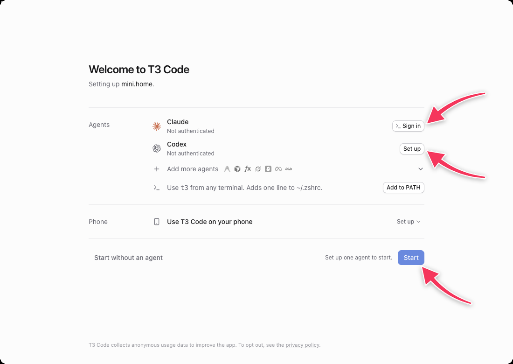
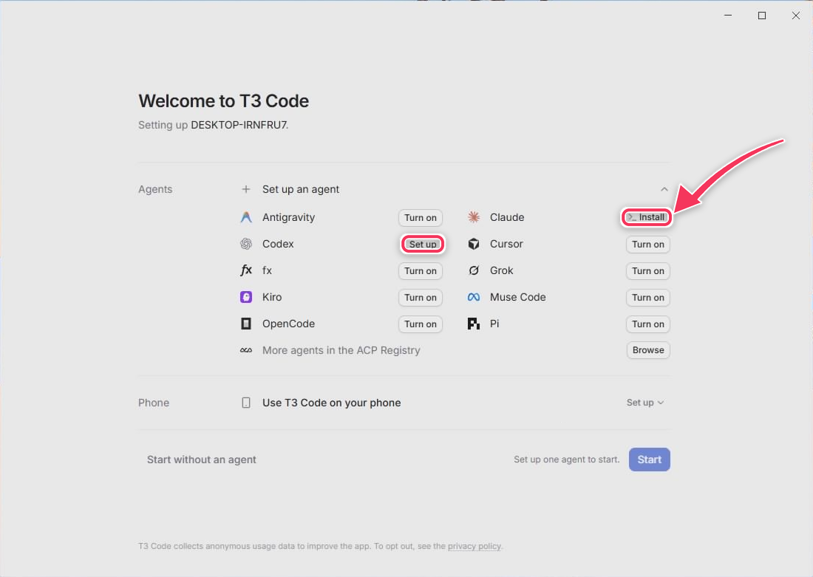
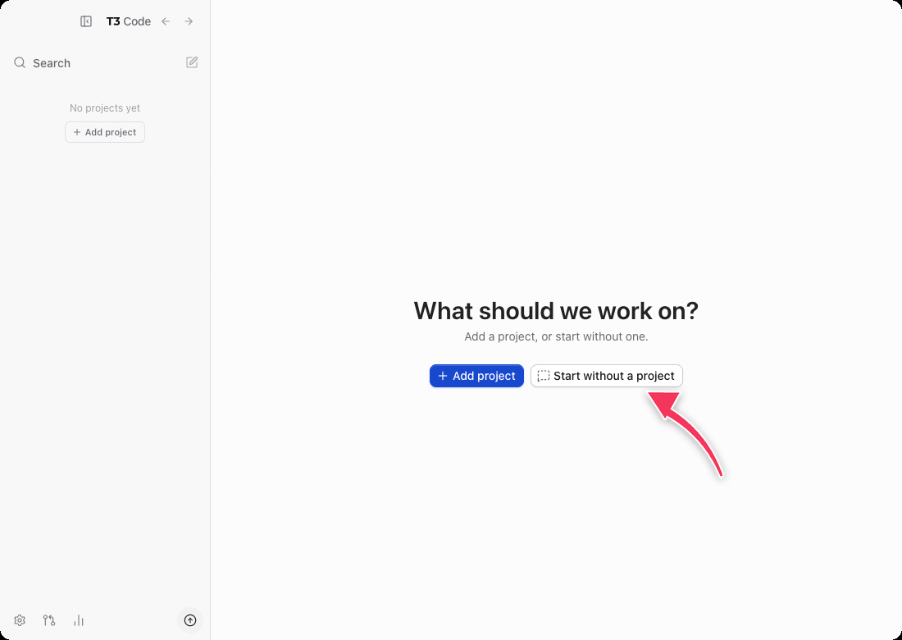
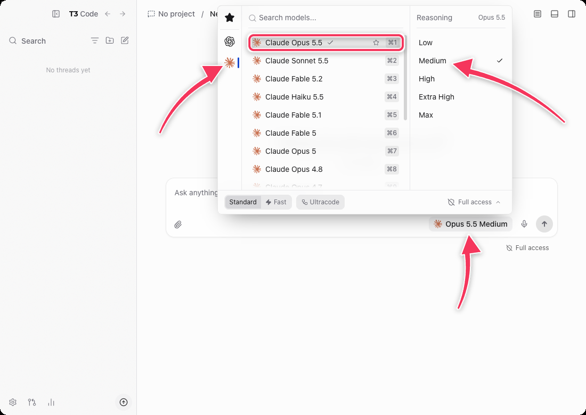
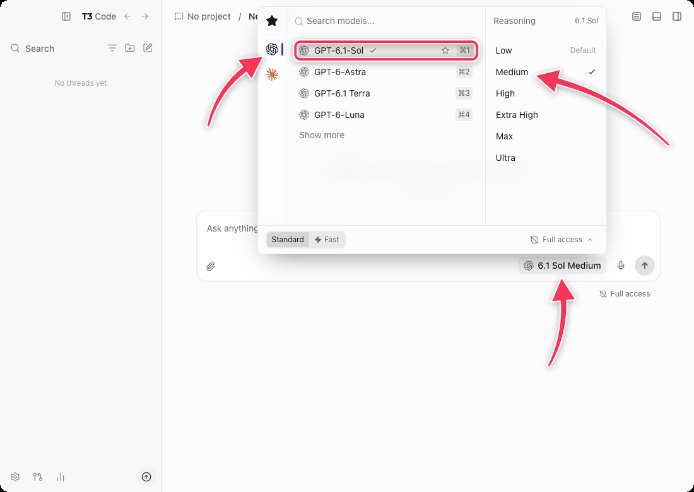
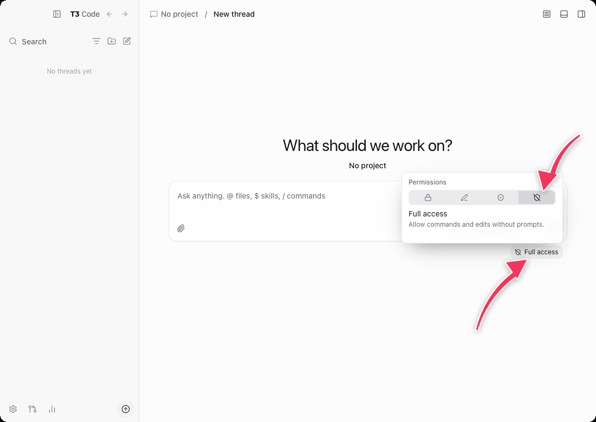
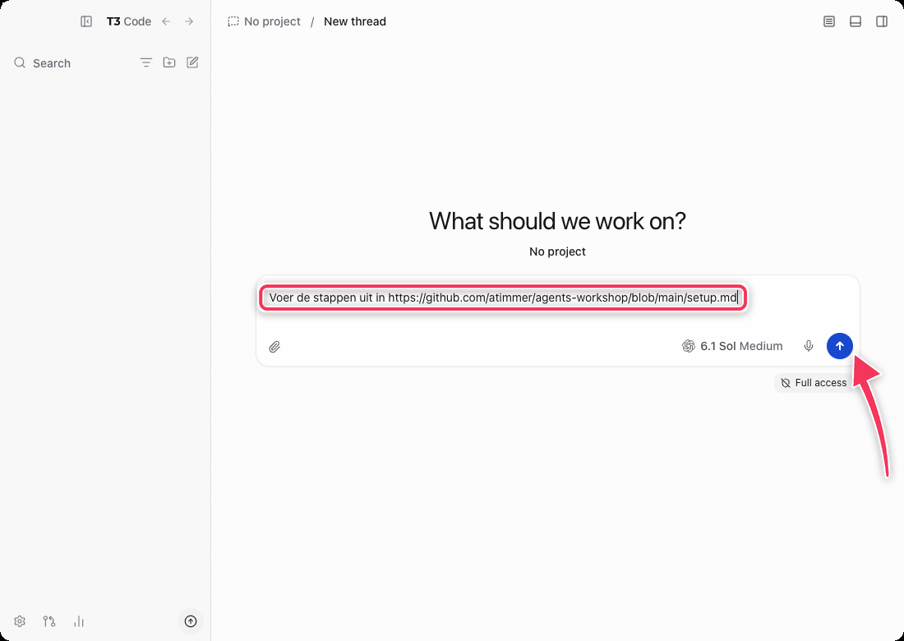
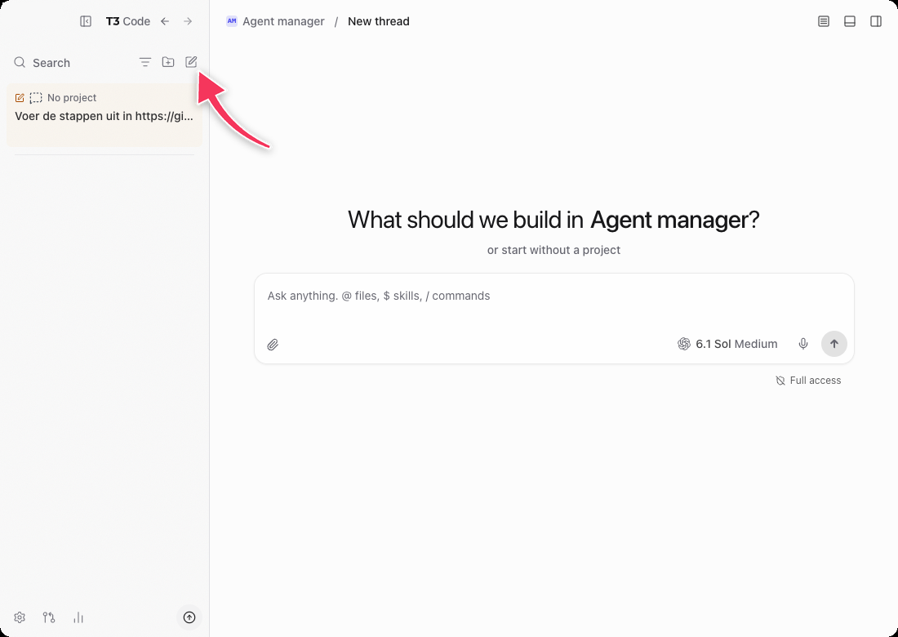
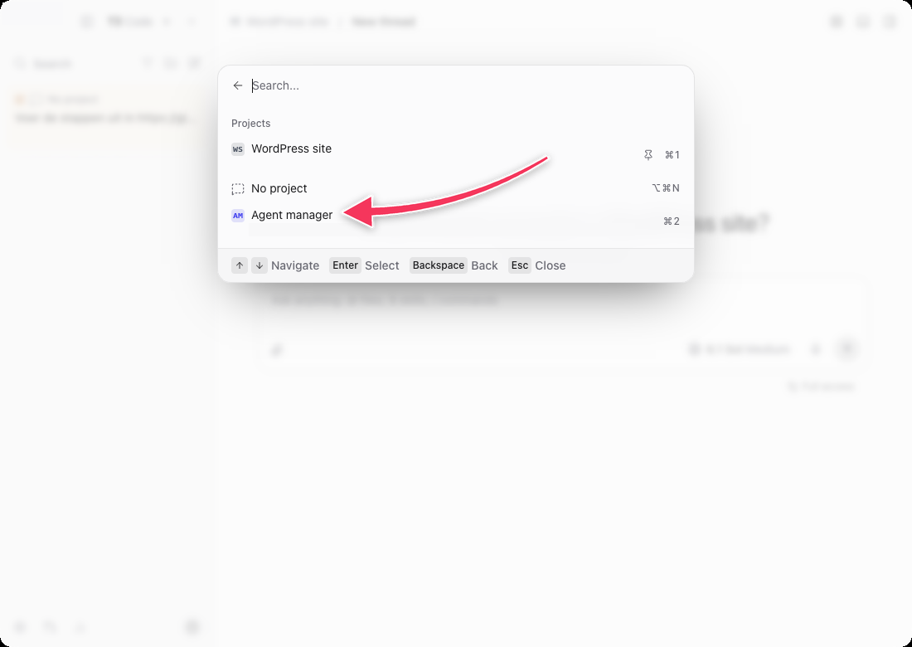

# Praktisch aan de slag met AI-agents

Workshop van Anton Timmermans op WordCamp Nederland 2026 (vrijdag 13 november).

In deze workshop zet je je eigen AI-agents op je laptop op. Elke agent is een eigen map met eigen instructies en een eigen geheugen. Eerst maakt de agent je laptop klaar. Daarna kies je aan welke workflow je als eerste werkt:

1. **E-mailassistent**: helpt je je inbox op te ruimen en stelt antwoorden voor. Werkt het best met Gmail of Google Workspace.
2. **Je WordPress-site, van binnenuit**: beantwoordt vragen over je berichten, pagina's en categorieën. Daarvoor installeer je twee plugins.
3. **Je website, van buitenaf**: controleert je site op SEO, toegankelijkheid, veiligheid en snelheid, volgens [The Website Specification](https://specification.website). Je hebt alleen de URL nodig.
4. **Zelf een workflow bedenken**: iets wat jouw dagelijkse werk het meest zou verbeteren.

Workflow 2 en 3 delen één agent, de WordPress-site-agent. Als je klaar bent met een workflow, kun je meteen de volgende kiezen.

Je hoeft niet te kunnen programmeren. De agent doet het werk en vraagt je om toestemming als dat nodig is.

## Wat heb je nodig

- Een laptop met Windows, macOS of Linux.
- Een betaald abonnement:
  - **Claude Pro** (of hoger): aanbevolen model Claude Opus 5.5.
  - **ChatGPT Plus** (of hoger): aanbevolen model GPT-6.1 Sol.

## Zo begin je

1. **Installeer T3 Code** via https://t3.codes, of via [GitHub Releases](https://github.com/pingdotgg/t3code/releases).
   - Windows: `winget install T3Tools.T3Code`
   - Mac: `brew install --cask t3-code`
2. **Open T3 Code.** Je ziet *Welcome to T3 Code*. Klik bij **Agents** op **Sign in** naast **Claude**, of op **Set up** naast **Codex**. Staat er eerst **Install**? Klik daar dan eerst op.
   - Bij Claude opent er een venster met een commando: druk op Enter.
   - Daarna log je in de browser in met je Claude- of ChatGPT-account.
   - Klik daarna op **Start**.
   - Windows: zie je een melding van *Windows Defender Firewall*? Klik op **Annuleren** (*Cancel*). T3 Code werkt gewoon.

   

   Op een computer waar Claude Code nog niet op staat, zie je eerst **Install** (hier op Windows). Daarna verandert die knop in **Sign in**.

   

3. **Start een nieuw gesprek.** Zie je *What should we work on?*: klik op **Start without a project**.

   

4. **Kies het model.** Klik onder het tekstvak op de modelnaam. Kies links het logo van Claude of van Codex, dan **Claude Opus 5.5** of **GPT-6.1-Sol**, en rechts onder *Reasoning* **Medium**.

   

   

5. **Controleer de toegang.** Rechtsonder het tekstvak staat de toegang. Die moet op **Full access** staan; dat is de standaard. Staat er *Supervised*, *Auto-accept edits* of *Auto*? Klik erop en kies het rechter icoon, **Full access**. Alleen dan kan de agent je agents als project aan T3 Code toevoegen. Hij vertelt je steeds wat hij doet en waarom.

   

6. **Plak dit bericht** en klik op het pijltje (of druk op Enter):

   ```text
   Voer de stappen uit in https://github.com/atimmer/agents-workshop/blob/main/setup.md
   ```

   

7. **Beantwoord de vragen van de agent.** De agent vraagt steeds één ding tegelijk. Is iets onduidelijk? Vraag het gewoon aan de agent, in je eigen woorden.

   > **If something is unclear, just talk to it.**

   Vraagt hij toestemming om iets uit te voeren? Lees kort wat het is en klik op **Approve**. Vraagt hij je de toegang op Full access te zetten? Doe dat zoals bij stap 5 en stuur dan *klaar*.

Gaat er iets mis, of heb je T3 Code opnieuw opgestart? Start een nieuw gesprek en plak hetzelfde bericht nog een keer. De agent slaat over wat al klaar is.

## Na afloop

Elke agent is een eigen project in T3 Code. Wil je iets vragen aan een agent? Klik bovenaan de zijbalk op het potloodje (**New thread**), kies het project van die agent, en stel je vraag.





Je agents staan in de map `agents` in je thuismap. Daar staan ook twee gedeelde bestanden: `README.md` legt uit waarom elke agent een eigen map heeft, en met `AGENTS.md` kunnen je agents elkaar via T3 Code inschakelen. Elke agent heeft een eigen Git-geschiedenis, en als je wilt ook een privé-back-up op GitHub.

Iedereen krijgt ook een **Agent manager**. Die weet welke agents je hebt, legt uit hoe de map werkt en maakt nieuwe agents voor je: start een nieuw gesprek in zijn project en vertel wat je nodig hebt. Aan het eind van de voorbereiding stelt hij zich in een eigen gesprek aan je voor.

## Voor de nieuwsgierigen

- [`setup.md`](setup.md): de stappen voor de agent (Engels)
- [`templates/`](templates/): de startbestanden per agent, ook van de Agent manager en zijn skill om nieuwe agents te maken
- [`docs/connectors.md`](docs/connectors.md): hoe de koppelingen werken, en wat nog niet getest is
- [`docs/icons.md`](docs/icons.md): de stijlen voor agent-iconen

Licentie: MIT.
